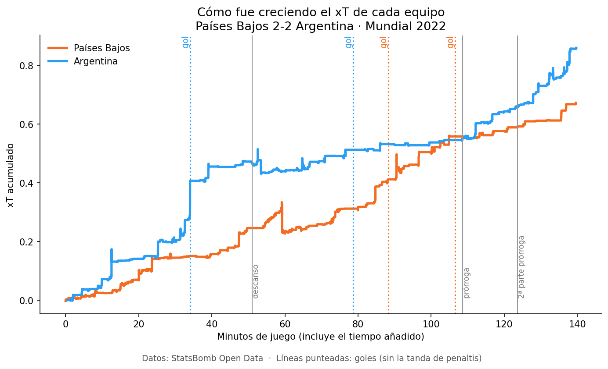
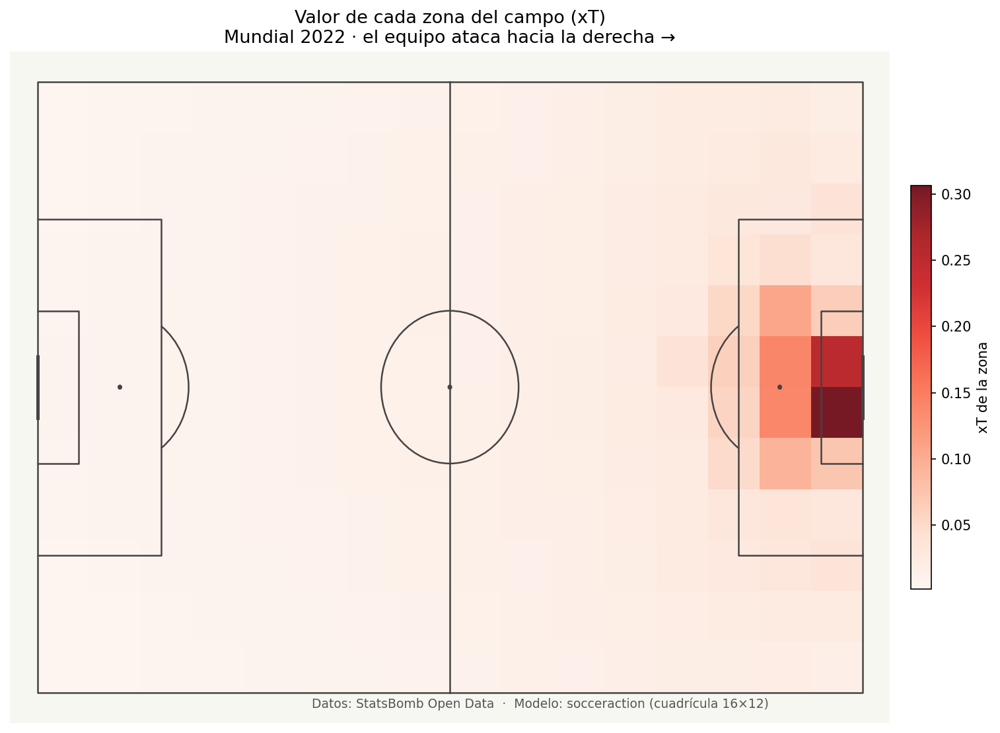
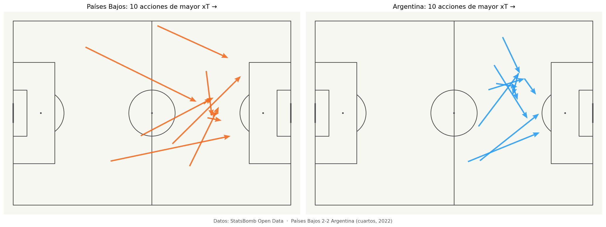
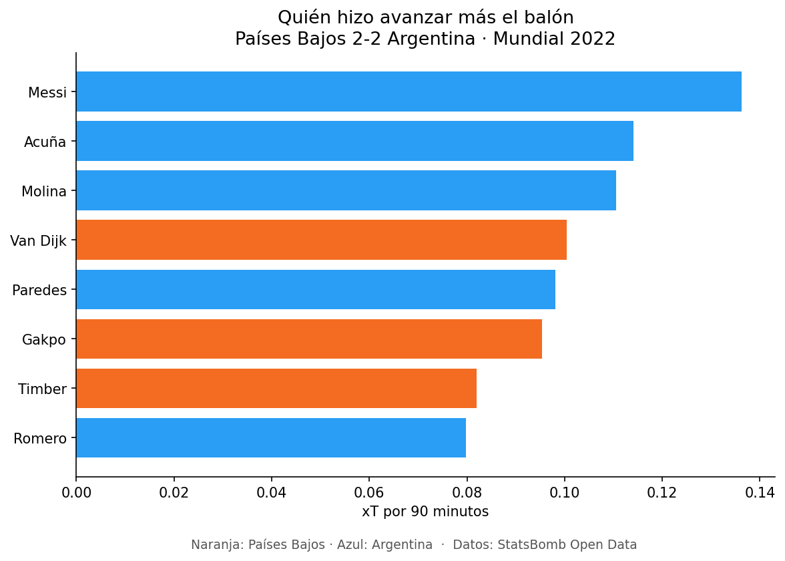

# xT (Expected Threat) en el Mundial 2022 con socceraction

Entreno un modelo de xT con los 64 partidos del Mundial 2022 y lo uso para ver cómo hicieron avanzar el balón Países Bajos y Argentina en su cuartos de final (**2-2**, Argentina ganó en los penaltis).

El xT mide cuánto sube el peligro de una zona del campo a otra con cada pase o conducción. Aquí lo calculo con [socceraction](https://github.com/ML-KULeuven/socceraction) y datos abiertos de StatsBomb.



## Qué respondo

**¿Cómo hizo avanzar el balón cada equipo?**

- Argentina suma **0,86** de xT frente a **0,67** de Países Bajos.
- Argentina va por delante casi todo el partido, Países Bajos recorta en la segunda parte y en la prórroga Argentina vuelve a distanciarse.
- Messi lidera el ranking, pero **casi la mitad de su xT viene de conducciones**. Si solo se cuentan pases, lidera Van Dijk.

| Jugador | Equipo | xT (pases y conducciones) |
|---|---|---|
| Lionel Messi | Argentina | 0,21 |
| Virgil van Dijk | Países Bajos | 0,16 |
| Nahuel Molina | Argentina | 0,15 |
| Cody Gakpo | Países Bajos | 0,14 |
| Jurriën Timber | Países Bajos | 0,13 |

Solo con pases: Van Dijk 0,14, Gakpo 0,12 y Messi 0,12.

## Visualizaciones

**Valor de cada zona del campo**



**Las 10 acciones de mayor xT de cada equipo**



**xT por 90 minutos de cada jugador**

Los 8 jugadores con más xT por 90 minutos (mínimo 45 minutos jugados). Naranja: Países Bajos, azul: Argentina.



## Cómo funciona

1. Cargo los 64 partidos del Mundial 2022 con `StatsBombLoader`.
2. Convierto los eventos al formato SPADL (acciones con punto de inicio y fin) y giro el campo para que todos ataquen hacia la derecha.
3. Entreno el modelo de xT sobre una cuadrícula de 16×12 zonas, sin la tanda de penaltis.
4. Valoro los pases y conducciones del Países Bajos-Argentina y los agrupo por jugador, equipo y minuto.

## Cómo ejecutarlo

Necesitas Python 3.9. En PowerShell:

```
git clone https://github.com/ikergisbertf14/xt-mundial-2022-socceraction.git
cd xt-mundial-2022-socceraction
python -m venv .venv_xt
.\.venv_xt\Scripts\Activate.ps1
pip install -r requirements.txt
```

Después abre `xt_mundial_2022.ipynb`, elige el kernel `.venv_xt` y pulsa *Run All*.

El notebook descarga los 64 partidos desde GitHub, así que tarda unos minutos. Si sale un error **429**, GitHub está limitando las descargas: espera unos minutos y vuelve a ejecutarlo.

## Limitaciones

- El xT premia el avance del balón, no la dificultad del pase.
- Las conducciones no vienen de los datos: las infiere socceraction entre acciones consecutivas, y a veces unen cosas que no son una conducción real. La mayor caída del gráfico (minuto 59) es una "conducción" de 35 metros entre un pase fallado y un saque de banda.
- Con un solo partido valorado no se puede generalizar.

## Estructura

```
├── xt_mundial_2022.ipynb
├── requirements.txt
├── images/
├── LICENSE
└── README.md
```

## Datos y créditos

Datos: [StatsBomb Open Data](https://github.com/statsbomb/open-data), usados bajo sus condiciones de uso. Análisis hecho con datos de StatsBomb.


## Licencia

MIT. Mira el archivo [LICENSE](LICENSE).